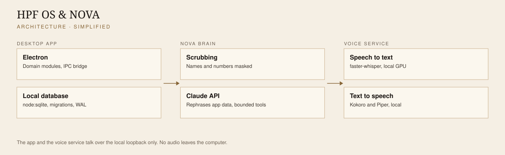

# HPF OS & NOVA

> A local-first work environment with a voice assistant that reformulates the app's own data.

**Status** · In use &nbsp;·&nbsp; **Area** · Software & Artificial Intelligence &nbsp;·&nbsp; **Source code** · private, documentation only

### At a glance

- One place that answers: what should I do now?
- Voice recognition and synthesis run locally.
- The assistant never sees a patient name.

## The problem

Studies, clinical work, laboratory production, finances and projects lived in a patchwork of spreadsheets, scripts and separate tools.  
There was no single place to answer the question: what should I do now?  

## The solution

One desktop environment that turns tasks, agenda, exams and production into clear priorities, with NOVA, a voice assistant that never sees patient names.

## My role

Software architecture and development.  
The project started from organising studies, clinical work and design production in one place.

## Key features

- Dashboard of priorities drawn from tasks, alerts, exams and invoices.
- Tasks and agenda synchronised with standard calendars.
- Revision planner across upcoming exams, with load limits per day.
- Laboratory production follow-up.
- A CAD mode that frees resources during design work.
- NOVA: local speech recognition and synthesis, optional wake word, animated orb.
- NOVA actions are bounded: open a screen, add a task or a reminder; anything else is only proposed for confirmation.

## Screenshots

All screenshots use demonstration or synthetic data.

NOVA orb, listening state · design mockup

## Technologies

Electron · Node.js · SQLite · Python · faster-whisper · Kokoro · Piper · Anthropic Claude API

## Architecture

- Only scrubbed text reaches the language model; figures come from the app and are never computed by the model.
- Separate Python voice process with size-capped inputs and logs that record durations, never content.
- Prompt caching and a spending cap on model calls.

## Development status

- In use since November 2026 as my own work environment.
- NOVA voice in service since mid-November 2026; some optimisations are still under evaluation.
- Screenshots of the live app would show personal data, so only a design mockup is shown.

## Privacy and code availability

- Local database, local speech recognition and synthesis, local wake word.
- Patient names are replaced by codes and long account numbers are stripped before any model call.
- No payment and no deletion can be triggered by the assistant.
- The source code of HPF OS & NOVA is proprietary and kept in a private repository.
- This repository contains documentation and demonstration screenshots only.
- Demonstrations can be arranged on request.

---

[Hugo Philippe Fusaro](https://github.com/hugophilippefusaro) · [HPF Dental Solutions](https://github.com/hpfdentalsolutions) · [hpfdentalsolutions.com](https://hpfdentalsolutions.com)  
© 2026 Hugo Philippe Fusaro. All rights reserved on texts and images.
